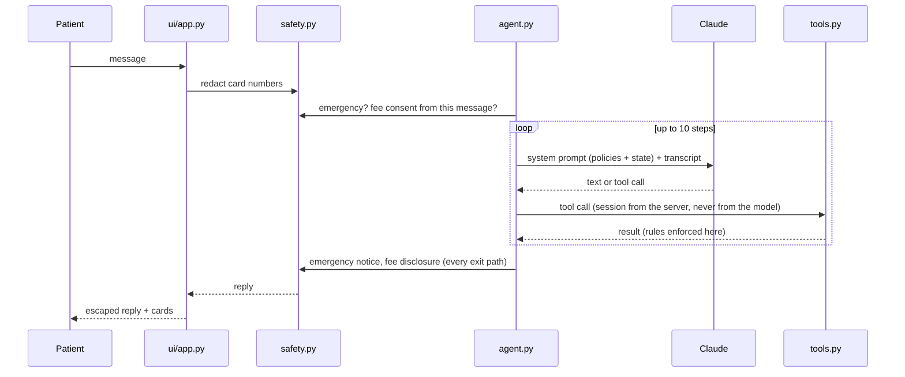

# Clara: Patient Access Agent for Sierra Valley Health
**Sean Hudgins · a project for learning the Claude API and agent design**

Clara is the first-line agent for the Sierra Valley Health Patient Access Center. Her job is to resolve routine requests (scheduling, refill requests, general questions) and hand everything else to staff with enough context that the patient never has to repeat themselves. The design principle throughout: **the model decides what to say; code decides what is allowed.** Anything that carries patient risk (identity, consent to a fee, controlled substances, referrals) is enforced in a tool, where the model can't talk its way around it.

---

## 1. Architecture overview

| Component | File | Job |
|---|---|---|
| UI | `ui/`, `main.py` | A fictional hospital homepage with Clara in a drawer. Chat cards (open times, read-backs, receipts), four channels (web, portal, SMS, voice), a presenter view, and one session object per browser tab. |
| Agent loop | `agent.py` | Builds the system prompt, calls Claude with the tool schemas, dispatches tool calls, loops until Claude answers in text (10-step cap). The model client is injected, so tests run the loop offline. |
| Safety | `safety.py` | Guardrails that don't depend on the model: emergency check and per-channel notice, card-number redaction, and late-fee disclosure and consent. Applied on every exit path of a turn. |
| Tools | `tools.py` | Ten tools with JSON schemas. Business rules live here, in code. |
| State / memory | session dict | Who is verified, failed-attempt count, a pending late fee, and the full transcript including tool calls and results. Kept server-side; never sent to or editable by the model. |
| Knowledge | `knowledge_base.py` | Hospital policies (hours, locations, parking, visit prep, insurance, portal, refills), injected verbatim into the system prompt on every turn. |
| Data | `data_store.py` | One interface over in-memory data or a Google Sheet; handoffs can go to Salesforce Cases. Stands in for the EHR and the contact center queue. |

**Tools:** `verify_patient`, `list_appointments`, `get_availability`, `book_appointment`, `cancel_appointment`, `list_prescriptions`, `submit_refill_request`, `get_home_device_status`, `get_billing_statement`, `handoff_to_staff`.

**How one request flows** ("Can you refill my meds?"):

1. The UI passes the message and the tab's session to `agent.chat()`.
2. The agent rebuilds the system prompt: policies, plus a *conversation state* line saying whether the caller is verified. Claude sees the caller isn't, and the request is ambiguous.
3. Claude asks which medication and for name + date of birth. No tool call yet.
4. The caller answers. Claude calls `verify_patient`; the tool matches name + DOB against patient records and, on success, writes the patient ID into the session. The model never handles the patient ID.
5. Claude calls `submit_refill_request("lisinopril")`. The tool reads the patient from the session, matches the medication against that patient's active prescriptions, rejects controlled substances, and records a request with status `pending_provider_review`.
6. Claude reports the result in plain language: a request, not an approval, with the reviewing provider and timeframe.

## 2. Conversation and decision design

**Intent** is recognized by Claude against the system prompt rather than a separate classifier. With ten tools and a short policy list, a single well-structured prompt is accurate enough and much simpler to change; a classifier becomes worth it at higher volume or for routing across many queues.

Every turn resolves to one of four moves, and the prompt states the rule for each:

| Move | When | Example |
|---|---|---|
| **Answer** | General question covered by policy | Parking, hours, portal password reset. No verification needed. |
| **Ask** | Ambiguous, or missing a required slot | "My knee": primary care or orthopedics? "Refill my meds": which one? One question per reply. |
| **Act** | Have the slots, and the caller is verified for anything patient-specific | Verify, search availability, offer up to 3 slots, book after explicit confirmation. |
| **Hand off** | Out of scope or unresolvable | Symptoms, test results, medication questions, billing disputes, controlled substances, failed verification. |

**Slot collection** is conversational, not a form: the prompt lists what each workflow needs (booking: reason, specialty or provider, timing, visit type) and Claude gathers what's missing across turns. Tools validate the result, so a slot the model gets wrong fails safely. For example, booking requires an exact `provider_id` and `start_time` from a prior availability search.

**Confirmation gates** sit in front of consequential actions. Booking requires the caller to choose and confirm a slot, and cancelling requires a read-back; today those two are prompt rules, and moving them into a code-owned pending-action step is the next change (see section 6). The late-cancellation fee is already code-owned end to end: inside 24 hours `cancel_appointment` refuses and records a pending fee; when the turn ends, `safety.py` always appends its own sentence naming the appointment and the fee (per channel, built from constants); and only the patient's next message, if it is a plain yes from a closed set of affirmatives (questions and conditions never count), records consent, for that one turn. The model's own words never count as disclosure. The model has no parameter to assert agreement. An earlier version let the model pass `acknowledge_late_fee=true`, and in testing it did so after a plain "yes" to cancelling, without the fee ever appearing in its text. Rescheduling books the new slot before cancelling the old one, so a failure midway never leaves the patient without an appointment.

**Handoff** goes through `handoff_to_staff(queue, summary, priority)`. Queues: `nurse_line` (clinical), `provider_office` (controlled substances), `billing`, `scheduling` (referrals, complex cases), `patient_access` (failed verification, anything else). The summary is 2-3 sentences written for the staff member: what the caller wants, what Clara already checked, and anything time-sensitive. Staff need to reach the caller, so the tool refuses an unverified handoff without a name and callback number. Clara then tells the caller who will follow up and when. Emergencies are never handed off; see section 4.

**Memory:** the session keeps the full transcript, including tool calls and results, not just the visible chat. An early build reconstructed context from the visible chat only; the model then lost the `provider_id` from an earlier availability search and booked the right time with the wrong doctor. Keeping tool results in state fixed it, and is the right model for a real deployment too.

## 3. System prompt

The prompt in use is `_SYSTEM_PROMPT_TEMPLATE` in [`agent.py`](agent.py). Its structure:

1. **Role and scope:** Clara, Patient Access Center, what she resolves and what she hands off; short replies because patients may be on a phone or a call.
2. **Safety rules that override everything:** emergencies first; no clinical advice; verify before disclosing or changing anything; never invent facts; refills are requests, never approvals; collect only what's needed.
3. **How to decide:** the answer / ask / act / hand off rules above, with worked examples of ambiguous requests.
4. **Workflows:** booking, cancelling, rescheduling, refills.
5. **Policies:** the knowledge base, verbatim.
6. **Conversation state:** rebuilt every model call from the session (verified as "Maria Lopez" / "NOT verified yet, 1 failed attempt"), so the model always knows who it's talking to without having to remember it. It sits in a `<state>` block marked as data, and names from the records store are JSON-quoted, so a record edited to contain instructions can't pose as part of the prompt.

Rules that matter most are stated twice: once in the prompt, once in the tool's schema description. The ones that carry patient risk are also enforced a third time, in code.

## 4. Hallucination and safety controls

| Risk | Control |
|---|---|
| Invented appointment slots | Slots come only from `get_availability`. `book_appointment` accepts only an exact provider + start time that is still open; anything else fails. |
| Invented medications | Refills match only against the verified patient's active prescriptions; an unknown name returns the list on file instead. |
| Invented policy | Policies are injected verbatim each turn; the prompt forbids facts not in tools or policy, and offers a handoff instead. |
| Clinical advice | Prompt bans diagnosis, triage, results interpretation and medication advice; all of it routes to `nurse_line`. |
| Refill treated as approval | The tool can only create `pending_provider_review`; the prompt and schema both say "never an approval". |
| Controlled substances | Refused in code and routed to the provider's office. |
| Specialist without referral | `book_appointment` refuses new orthopedics or cardiology patients without a referral on file; Clara offers primary care or a scheduling handoff. |
| Provider not taking new patients | `book_appointment` refuses Dr. Shah for anyone not seen there before. |
| Fee charged without consent | The model can't assert consent; code shows the fee and reads the patient's own next message (section 2). |
| Duplicate requests | A second refill request for the same medication returns the pending one instead of creating another. |
| Runaway tool loops | 10-step cap with a safe fallback that includes the phone number; the emergency notice is still added if the message called for it. |
| Tool errors | A failed tool returns a plain message (apologize, offer a handoff or the phone number), never Python exception text. |
| Prompt injection | Patient-specific tools read the verified patient from the server session; records are data in a delimited block; the UI escapes Clara's reply. Evals cover a direct attempt and an instruction planted in an appointment record. See `docs/threat-model.md`. |

## 5. Healthcare considerations

**Identity before disclosure.** `verify_patient` matches first name, last name and date of birth (DOB accepted in any common format). The verified patient ID lives in server-side session state; every patient-specific tool reads it from there, so the model cannot query or change another patient's record even if prompted to. Failures return a generic message that doesn't reveal which field was wrong, and verification locks after three failed attempts, routing to a human. Another patient's appointment ID is reported as "not found" rather than "not yours". *In production:* name + DOB is a weak factor. I'd add a second factor such as a one-time code to the phone or email on file, use authenticated portal or caller-ID context where available, handle proxy access (parents, caregivers) explicitly, and step up verification before higher-risk actions.

**PHI handling.**
- *What goes to the LLM:* only what the current task needs. Tools return minimal fields (no full chart, no other patients); the prompt tells Clara not to collect medical history, and handoff summaries carry only what staff need.
- *Vendor agreements:* a BAA with the model provider, with zero-data-retention or equivalent settings, plus BAAs with hosting, the contact center platform and any CRM.
- *Logging:* transcripts are PHI. Store them encrypted, access-controlled and retained per policy. Operational logs (latency, tool names, error codes, safety-gate firings) should be redacted of identifiers so engineers can debug without PHI access. An immutable audit log records each record access and change: who, which patient, which tool, when.
- *Redaction:* an entity-detection pass before logging and analytics; keep raw PHI only in the system of record.

**Emergency and self-harm language.** Handled in two layers. The prompt makes emergencies the first rule: direct to 911 or the nearest ER, and to 988 for self-harm, before anything else, without queuing. A keyword check in `safety.py` (English and Spanish, normalised for case, accents and apostrophes) reads the caller's message before the model runs. If it matches, the code-owned plain-text notice for that channel (911 and 988; in Spanish for Spanish triggers) is put first in whatever reply the patient gets, including the fallback when the model call fails, returns nothing, is refused or hits the step cap. It is a keyword floor, not a classifier: it catches common phrasings, and the model handles the rest. On voice, I'd add a warm transfer to a live clinician or 911 bridge rather than a callback. *In production:* replace the regex with a dedicated classifier tuned for recall, and have clinical leadership review the phrase list and responses.

**Refills as requests.** There is no code path that approves a refill. Every request lands as `pending_provider_review` with the prescriber and preferred pharmacy attached, and Clara tells the patient it's a request the provider will review within 2 business days.

## 6. Production readiness

**What I cut to move fast:**
- Mocked EHR, scheduling and pharmacy data (in memory or a Google Sheet). A spreadsheet has no transactions, row-level security or PHI-grade audit trail; it's for demo visibility only.
- Name + DOB as the only identity factor.
- A regex (English and Spanish) as the emergency backstop rather than a classifier.
- SMS and voice are simulated in the web drawer, not connected to a phone network.
- No structured monitoring or server-side audit log yet.
- Booking and normal-cancel confirmation are prompt rules, not yet code-owned.
- Verification lockout is per conversation; a new tab starts over. Production needs per-record and per-client throttling.

**What I'd change to deploy:**
- **EHR integration:** FHIR `Patient`, `Slot`, `Appointment`, `MedicationRequest` and `Task` resources (or the EHR's scheduling API), with retries, timeouts and idempotency keys. Slot booking must be transactional to avoid double-booking under concurrency.
- **Handoff into the contact center:** `handoff_to_staff` becomes a transfer into the right queue with the summary attached to the interaction: a screen pop for the agent, a whisper on voice, the conversation history on chat. Callback requests become queue-routed tasks with SLAs. In a contact center platform, the queues map to contact center queues and the summary to the agent's context panel.
- **Evaluation (built):** offline guardrail tests run in CI on every push (`tests/`), and a 21-scenario conversation eval graded by Claude, with safety scenarios always graded by Opus (`evals/model_eval.py`). Next: repeat runs per scenario to measure variance, deterministic trace assertions in the evals, and a committed results summary.
- **Monitoring:** containment rate, handoff rate by queue, verification failure rate, safety-gate firings, tool error rates, latency and cost per conversation, with alerts on spikes.
- **Voice latency:** stream TTS from the first sentence, use a faster model for turn-taking with the larger model only for tool-heavy steps, prefetch availability once intent is clear, and keep spoken replies to one or two sentences with confirmation read-backs for dates and names.

**Model choice.** The agent runs on `claude-haiku-5-5` at low effort (`CLARA_MODEL` overrides it). An earlier build ran on a larger model because a smaller one sometimes described a handoff instead of calling the tool. Once the eval suite existed, the bake-off showed Haiku 5.5 matching Opus 5.5 on every safety check at a fraction of the cost, so it became the default. The evals are what made that switch safe to make.

## 7. Assumptions

- Patients start unauthenticated (a phone call or a public chat), so verification happens in the conversation.
- "New patient" for referral purposes means no prior non-cancelled appointment with that provider.
- Orthopedics and Cardiology require a primary care referral for new patients; primary care and dermatology don't.
- A cancellation less than 24 hours ahead carries a $50 fee.
- Refill decisions take up to 2 business days; nurse callbacks happen within 2 hours during clinic hours.
- Sarah Bellum, Dr. Reed and Dr. Shah exist to cover the controlled-substance and second-specialty cases. Slot times are generated relative to today rather than fixed dates, so the demo doesn't go stale.
