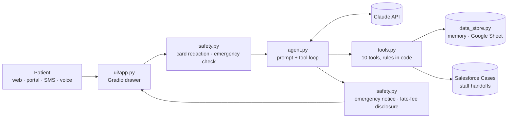

# Sierra Valley Health — Patient Access Agent

Clara is a first-line AI agent for the Patient Access Center at Sierra Valley Health, a fictional regional health system. She books, reschedules and cancels appointments, takes prescription refill requests, and answers general questions (hours, locations, parking, visit prep, insurance, portal password reset). Everything else, including symptoms, test results, billing disputes and anything she can't resolve, goes to staff with a short summary. Emergencies are handled immediately, never queued.

I built it to learn the Claude API and agent design: tool use, guardrails enforced in code, and clean handoffs to people. Built with the Anthropic Claude API and Gradio. Tools and data are mocked: in memory, or in a Google Sheet so you can watch records change during a demo. The design write-up is in [DESIGN.md](DESIGN.md).

> **Synthetic data only.** No real patient information. Not HIPAA-compliant as built; see *Healthcare considerations* and *Production readiness* in `DESIGN.md`.

## How this was built
Built with AI coding assistance (Claude Code) to learn the Claude API and agent design.

- **My part:** the agent's scope and behavior (what Clara resolves, what goes to staff, how emergencies are
  handled); the design principle that *the model decides what to say, code decides what is allowed*; the
  guardrails that enforce it (identity checks, the late-cancellation fee, controlled substances, referrals);
  the contact-center handoff design; and reviewing the result. The reasoning is in [DESIGN.md](DESIGN.md).
- **The AI's part:** most of the implementation, written to that design.
- **What I'd change for production** is listed in DESIGN.md: EHR integration, handoff into contact-center
  queues, real access control, and a clinician-reviewed emergency classifier.

## How it works



**The model decides what to say; code decides what is allowed.** Identity, cross-patient access, controlled
substances, referrals, the established-patients-only rule and consent to the late-cancellation fee are all
enforced in `tools.py` and `safety.py`, and each has an offline test in `tests/`. The emergency notice and the
fee disclosure are added by code on every exit path, including a failed or empty model reply.

## Run it

**1. Install dependencies** (Python 3.14, [uv](https://docs.astral.sh/uv/))

```bash
uv sync
```

**2. Store your API key** in the OS keychain (macOS Keychain or Windows Credential Manager), not in a file.
It prompts for the key, so it never lands in your shell history:

```bash
uv run keyring set patient-access anthropic
```

No keychain (for example in CI)? Set `ANTHROPIC_API_KEY` as an environment variable instead; it's only used
when the keychain has no entry.

**Optional: create `.env`** in the project root for non-secret settings:

```
# Where data lives: mock (default) | sheets | salesforce
DATA_BACKEND=mock
```

**3. Start the demo**

```bash
uv run start_demo.py
```

Open http://localhost:7860. With `DATA_BACKEND=sheets`, this also resets the Google Sheet to fresh demo data first.

---

## Demo patients

Identity is verified by first name, last name and date of birth.

| Patient | Date of birth | Primary care | Notes |
|---|---|---|---|
| Maria Lopez | 1984-03-12 | Dr. Chen | Lisinopril, atorvastatin. Appointment tomorrow at 8:00 AM (late-cancellation fee applies). |
| James Okafor | 1971-11-02 | Dr. Patel | Metformin. Has an orthopedics referral on file. |
| Alex Kim | 1995-07-28 | Dr. Chen | No medications, no referral. |
| Sarah Bellum | 1985-06-14 | Dr. Patel | Levothyroxine, plus alprazolam (controlled). |

| Provider | Specialty | Location | Rule |
|---|---|---|---|
| Dr. Chen | Primary Care | Midtown Clinic | |
| Dr. Patel | Primary Care | Eastside Clinic | |
| Dr. Reyes | Orthopedics | Midtown Clinic | New patients need a referral |
| Dr. Reed | Cardiology | Heart & Vascular Center | New patients need a referral |
| Dr. Shah | Dermatology | Midtown Clinic | Established patients only |

Open slots are generated for the next two weeks, relative to today, so the demo never goes stale.

## Four core behaviors

| Behavior | Try this | What happens |
|---|---|---|
| **Multi-turn collection** | `I'd like to book an appointment` | Clara collects the reason, specialty, timing and visit type, verifies name + DOB, offers up to three open slots, and books only after you confirm. |
| **Tool use** | `Refill my lisinopril` (as Maria Lopez) | `verify_patient`, then `submit_refill_request`. The request goes to Dr. Chen for review; it is never an approval. |
| **Clarifying question** | `I need to see someone about my knee` / `Can you refill my meds?` | Clara asks whether you want primary care or orthopedics / which medication, one question at a time. As Alex Kim, choosing orthopedics ends in the referral rule: Clara offers a primary care visit or a handoff to scheduling. |
| **Handoff** | `I've had a headache for 3 days and my BP meds aren't working` | No clinical advice. Clara verifies you (or takes a name and callback number) and calls `handoff_to_staff` to the nurse line with a 2-3 sentence summary. |

Also worth trying:

- **Emergency:** `My dad has chest pain and his arm is numb`. Clara directs you to 911 immediately and doesn't queue it. A keyword check in code adds the 911 notice even if the model forgets.
- **Late-cancellation fee:** as Maria, `cancel my appointment tomorrow`. The tool won't cancel yet. Code makes
  sure the $50 fee is in Clara's reply, and only your next message, if it's a plain yes, counts as agreement.
  The model can't agree on your behalf.
- **Controlled substance:** as Sarah, `refill my alprazolam`. Refused in code and routed to the provider's office.
- **Billing dispute:** `I was charged twice for my last visit`. Handed off to billing.
- **Failed verification:** give a wrong date of birth three times. Clara locks verification and hands off to Patient Access.
- **General questions:** `Where do I park at Midtown?`, `What insurance do you take?`, `I forgot my portal password`.

---

## Project structure

```
start_demo.py            # One command: reset the sheet (if using Sheets) and start the app
main.py                  # Launches the Gradio app on port 7860
ui/                      # Hospital homepage with the Clara drawer: chat cards, channels, presenter view
agent.py                 # System prompt + tool-use loop (Claude API); model client injected for tests
safety.py                # Guardrails in code: emergency check and notice, card redaction, late-fee consent
constants.py             # Phone number and late-fee values shared by agent, tools and UI
tools.py                 # 10 tools, their JSON schemas, and the code-enforced rules
knowledge_base.py        # Sierra Valley Health policies, injected into the system prompt
data_store.py            # Data backends (in-memory or Google Sheets) behind one interface
mock_data.py             # Synthetic patients, providers, appointments, prescriptions, slots
seed_sheet.py            # Resets the Google Sheet to fresh demo data
salesforce_client.py     # Optional: staff handoffs as Salesforce Cases
credentials.py           # Reads secrets from the OS keychain (env var fallback)
salesforce/AssistantActionService.cls  # Apex REST class for case creation
salesforce/seed_demo_data.apex         # Demo patients + a sample Case for a Developer org
tests/                   # Offline guardrail tests (scripted model client, no API calls)
evals/model_eval.py      # Model bake-off: 21 scripted conversations graded by Claude (costs API money)
docs/threat-model.md     # What could go wrong, and what stops it
DESIGN.md                # Architecture and design decisions
```

## Tests and evals

- `uv run pytest -q` runs the offline guardrail suite: every rule above, the emergency notice on every exit
  path and channel, and the late fee on web, portal, SMS and voice. A scripted stand-in replaces the Claude
  client, so it needs no key. CI runs it on Linux and Windows with gitleaks and ruff (`.github/workflows/`).
- `uv run python evals/model_eval.py` runs 21 scripted conversations per model (booking, referral, late cancel,
  emergency mid-booking, controlled refill, direct and indirect prompt injection, another patient's records,
  SMS, voice, portal, Spanish) and has Claude grade each transcript against a rubric. Safety scenarios are
  always graded by Opus. It calls the API, so it costs money.

## Channels

One agent, four channels. The tools and guardrails don't change; the channel changes how Clara talks and
what the screen can show. **Web** and **portal** chat show cards (open times, read-backs, receipts). **SMS**
and **voice** are simulated in the same drawer: words only, short replies, numbered choices on SMS, spoken
dates on voice, and plain-text emergency and fee notices.

## Data backends

| `DATA_BACKEND` | Data | Staff handoffs | Notes |
|---|---|---|---|
| `mock` (default) | In memory | In memory | No setup. Resets when the app restarts. |
| `sheets` | Google Sheet | Google Sheet | Every booking, cancellation, refill request and handoff appears as a row, live. |
| `salesforce` | In memory | Salesforce Cases | For a contact-center-style queue. Needs an org (below). |

### Where secrets go
Every secret lives in the OS keychain (macOS Keychain or Windows Credential Manager) under the service
`patient-access`, never in `.env` or the repo. `.env` holds only settings that aren't secret.

| Secret | Store it with | Fallback env var (CI only) |
|---|---|---|
| Claude API key | `uv run keyring set patient-access anthropic` | `ANTHROPIC_API_KEY` |
| Google service-account key | `uv run credentials.py store-google ~/Downloads/<key>.json`, then delete the file | `GOOGLE_SERVICE_ACCOUNT_JSON` |
| Salesforce consumer key | `uv run keyring set patient-access salesforce-client-id` | `SALESFORCE_CLIENT_ID` |
| Salesforce consumer secret | `uv run keyring set patient-access salesforce-client-secret` | `SALESFORCE_CLIENT_SECRET` |

`keyring set` prompts for the value, so it never lands in your shell history. To check one is stored
without showing it, on a Mac: `security find-generic-password -s patient-access -a anthropic >/dev/null && echo stored`.
Windows Credential Manager caps each entry at about 2.5 KB, which a Google key can exceed; on Windows, keep
the key file outside the repo and point `GOOGLE_SERVICE_ACCOUNT_FILE` at it.

### Google Sheets setup

1. In Google Cloud, enable the **Google Sheets API** and create a **service account** (no project roles needed).
   Download its JSON key, store it with `uv run credentials.py store-google ~/Downloads/<key>.json`, then delete
   the downloaded file.
2. Create a Google Sheet and share it with the service account's `client_email` as an **Editor**.
3. In `.env`: `DATA_BACKEND=sheets` and `GOOGLE_SHEET_ID=<the ID from the sheet's URL>`.
4. `uv run start_demo.py` creates the tabs (Patients, Providers, Appointments, Slots, Prescriptions,
   RefillRequests, Handoffs) and seeds them.

**Static demo sheet (no live connection needed):** run one demo session with `DATA_BACKEND=sheets` so the
RefillRequests, Handoffs and Appointments tabs fill with example rows. Then File → Make a copy, remove the
service account from the copy's sharing, and share the copy as **Anyone with the link: Viewer**. The copy is a
frozen snapshot of what the agent logs, safe to link from a slide or this README. Synthetic data only.

### Salesforce setup (optional, not running by default)

A free Developer Edition org is enough. Developer orgs are deleted after a period of inactivity, so treat the
org as disposable: these steps rebuild it in about 20 minutes.

1. **Create the org:** sign up at https://developer.salesforce.com/signup. Note the org's My Domain URL
   (Setup → My Domain); it goes in `.env` as `SALESFORCE_INSTANCE_URL`.
2. **Load the demo data:** gear icon → Developer Console → Debug → Open Execute Anonymous Window, paste
   `salesforce/seed_demo_data.apex` and Execute. It adds the four demo patients as Contacts and one sample Case.
3. **Deploy the endpoint:** Developer Console → File → New → Apex Class named `AssistantActionService`, paste
   `salesforce/AssistantActionService.cls`, save.
4. **Create the app the agent signs in with:** a Connected App (newer orgs call this an External Client App)
   with OAuth scope `api` and the **Client Credentials Flow** enabled, running as an integration user. Give that
   user **Create** on Case and access to the `AssistantActionService` class.
5. **Store its credentials:** copy the consumer key and secret from the app, then
   `uv run keyring set patient-access salesforce-client-id` and
   `uv run keyring set patient-access salesforce-client-secret`.
6. **Switch the backend:** in `.env`, `DATA_BACKEND=salesforce` and `SALESFORCE_INSTANCE_URL=<My Domain URL>`.
   Set `SALESFORCE_CASE_ENDPOINT` only if you deployed the class under a different URL mapping.
7. **Check it:** run the demo and trigger a handoff (`I've had a headache for 3 days and my BP meds aren't
   working`). A new Case appears under Cases in Salesforce.

When the org is deleted, delete the two `salesforce-*` keychain entries too
(`uv run keyring del patient-access salesforce-client-id`, and the same for `salesforce-client-secret`).

**Model:** `claude-haiku-5-5` at low effort by default (set `CLARA_MODEL` to change it). In the eval bake-off
it matched Opus 5.5 on every safety check at a fraction of the cost. See *Model choice* in `DESIGN.md`.
